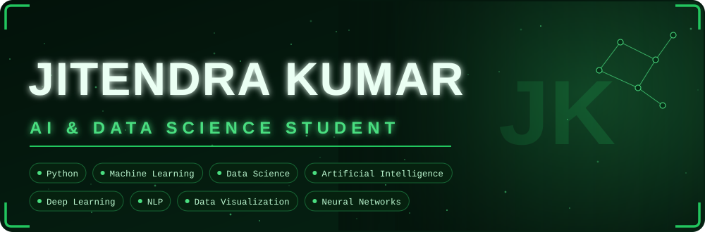
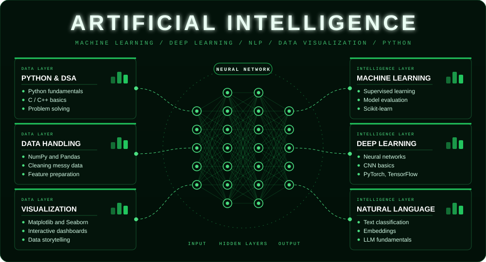
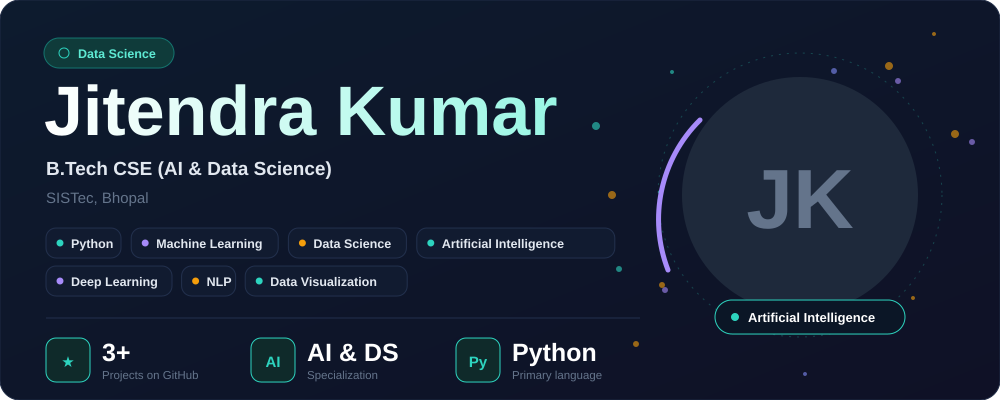
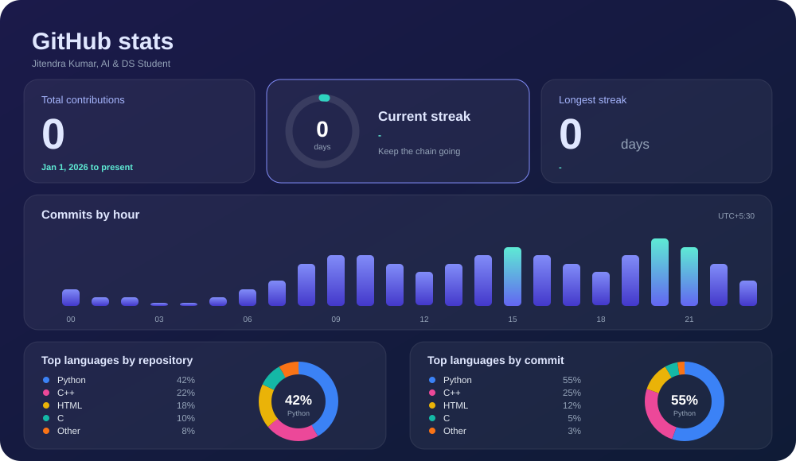
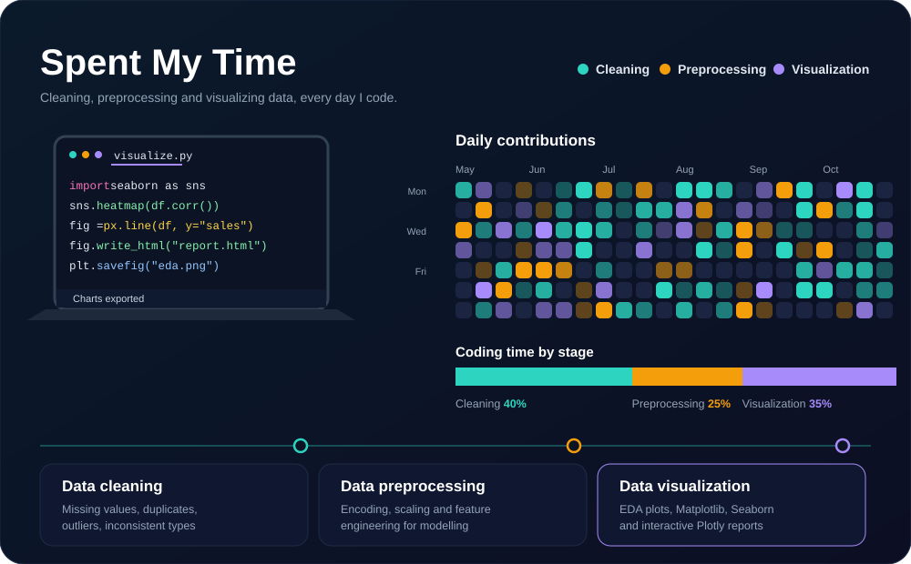

  
  

  

  

  

---

# Jitendra Kumar

**B.Tech Computer Science Engineering (AI & Data Science)**

**SISTec, Bhopal, India**

  

---

## 👨‍💻 About Me

I enjoy learning how complete software systems fit together, from programming fundamentals to data handling, machine learning, and building real projects.

- 🎓 **Degree / Field:** B.Tech in Computer Science Engineering (AI & Data Science)
- 🤖 **Focus Areas:** Artificial Intelligence, Machine Learning, Data Science
- 🐍 **Currently:** Learning Python and strengthening programming fundamentals
- 💻 **How I learn:** Building projects to improve coding and problem-solving skills
- 🎯 **Goal:** Grow into an **AI Engineer**

---

## 🌐 Socials

  
  
  <!-- Add more, e.g. email:
  
  -->

---

## 🚀 Featured Projects

  
  
  

---

## 🛠️ Tech Stack

### Languages

### AI / Machine Learning (learning)

### Tools

---

## 📊 GitHub Stats

  

  
  

  

---

## 💻 Spent My Time

  

---

## 🎯 My Learning Journey

> "Small steps every day lead to big achievements."

- 📖 Learn programming fundamentals
- 🧩 Practice problem-solving
- 🚀 Build and improve projects
- 🤖 Explore AI and Data Science
- 🌟 Keep learning and growing

---

### ✍️ Random Dev Quote

  

  <b>Thanks for visiting my profile! 😊</b>

