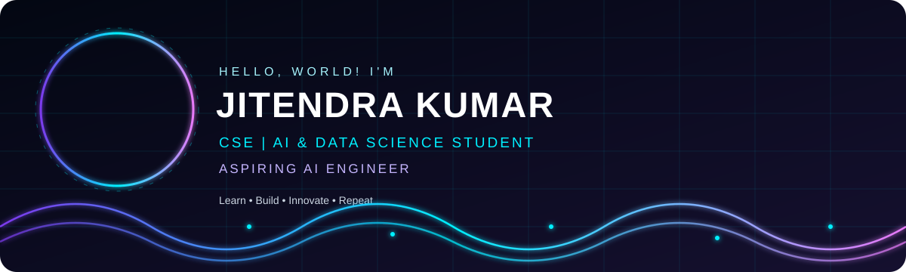

  

  
  

<h1 align="center">Jitendra Kumar</h1>
<h3 align="center">CSE | AI & Data Science Student | Aspiring AI Engineer</h3>
<svg xmlns="http://www.w3.org/2000/svg" width="1200" height="360" viewBox="0 0 1200 360">
  <defs>
    <linearGradient id="bg" x1="0" y1="0" x2="1" y2="1">
      <stop offset="0%" stop-color="#030712"/>
      <stop offset="100%" stop-color="#15102F"/>
    </linearGradient>
    <linearGradient id="neon" x1="0" y1="0" x2="1" y2="0">
      <stop offset="0%" stop-color="#7C3AED"/>
      <stop offset="50%" stop-color="#00F0FF"/>
      <stop offset="100%" stop-color="#E879F9"/>
    </linearGradient>
    <clipPath id="portrait">
      <circle cx="155" cy="145" r="91"/>
    </clipPath>
    <filter id="glow" x="-50%" y="-50%" width="200%" height="200%">
      <feGaussianBlur stdDeviation="3" result="blur"/>
      <feMerge><feMergeNode in="blur"/><feMergeNode in="SourceGraphic"/></feMerge>
    </filter>
  </defs>
  <rect width="1200" height="360" rx="22" fill="url(#bg)"/>
  <g stroke="#00F0FF" stroke-opacity=".09">
    <path d="M0 50H1200 M0 100H1200 M0 150H1200 M0 200H1200 M0 250H1200 M0 300H1200"/>
    <path d="M300 0V360 M400 0V360 M500 0V360 M600 0V360 M700 0V360 M800 0V360 M900 0V360 M1000 0V360 M1100 0V360"/>
  </g>
  <circle cx="155" cy="145" r="101" fill="none" stroke="url(#neon)" stroke-width="3" filter="url(#glow)"/>
  <circle cx="155" cy="145" r="108" fill="none" stroke="#00F0FF" stroke-opacity=".35" stroke-dasharray="5 10">
    <animateTransform attributeName="transform" type="rotate" from="0 155 145" to="360 155 145" dur="18s" repeatCount="indefinite"/>
  </circle>
  <image href="profile.png" x="64" y="54" width="182" height="182" preserveAspectRatio="xMidYMin slice" clip-path="url(#portrait)"/>
  <g font-family="Arial, sans-serif">
    <text x="290" y="100" fill="#A5F3FC" font-size="16" letter-spacing="5">HELLO, WORLD! I'M</text>
    <text x="286" y="155" fill="#FFFFFF" font-size="47" font-weight="bold" letter-spacing="2">JITENDRA KUMAR</text>
    <text x="290" y="195" fill="#00F0FF" font-size="19" letter-spacing="3">CSE | AI &amp; DATA SCIENCE STUDENT</text>
    <text x="290" y="229" fill="#C4B5FD" font-size="17" letter-spacing="3">ASPIRING AI ENGINEER</text>
    <text x="290" y="270" fill="#CBD5E1" font-size="14">Learn • Build • Innovate • Repeat</text>
  </g>
  <g fill="none" stroke="url(#neon)" stroke-width="2.5" filter="url(#glow)">
    <path d="M0 300 Q100 240 200 300 T400 300 T600 300 T800 300 T1000 300 T1200 300">
      <animate attributeName="d" dur="4s" repeatCount="indefinite"
        values="M0 300 Q100 240 200 300 T400 300 T600 300 T800 300 T1000 300 T1200 300;M0 300 Q100 350 200 300 T400 300 T600 300 T800 300 T1000 300 T1200 300;M0 300 Q100 240 200 300 T400 300 T600 300 T800 300 T1000 300 T1200 300"/>
    </path>
    <path d="M0 320 Q100 270 200 320 T400 320 T600 320 T800 320 T1000 320 T1200 320" opacity=".7">
      <animate attributeName="d" dur="3s" repeatCount="indefinite"
        values="M0 320 Q100 270 200 320 T400 320 T600 320 T800 320 T1000 320 T1200 320;M0 320 Q100 355 200 320 T400 320 T600 320 T800 320 T1000 320 T1200 320;M0 320 Q100 270 200 320 T400 320 T600 320 T800 320 T1000 320 T1200 320"/>
    </path>
  </g>
  <g fill="#00F0FF" filter="url(#glow)">
    <circle cx="330" cy="300" r="3"><animate attributeName="cy" values="300;280;300" dur="2s" repeatCount="indefinite"/></circle>
    <circle cx="520" cy="310" r="3"><animate attributeName="cy" values="310;330;310" dur="2.5s" repeatCount="indefinite"/></circle>
    <circle cx="730" cy="300" r="3"><animate attributeName="cy" values="300;280;300" dur="1.8s" repeatCount="indefinite"/></circle>
    <circle cx="950" cy="315" r="3"><animate attributeName="cy" values="315;335;315" dur="2.2s" repeatCount="indefinite"/></circle>
    <circle cx="1100" cy="300" r="3"><animate attributeName="cy" values="300;280;300" dur="2s" repeatCount="indefinite"/></circle>
  </g>
</svg>

  

---

## 👨‍💻 About Me

I'm a B.Tech Computer Science Engineering student specializing in AI & Data Science at SISTec, Bhopal, India.

- 🤖 Interested in Artificial Intelligence, Machine Learning, and Data Science.
- 🐍 Learning Python and strengthening programming fundamentals.
- 💡 Building projects to solve practical problems.
- 🧩 Improving my logic and problem-solving skills.
- 🎯 Goal: Become an AI Engineer.

---

## 🛠️ Tech Stack

  

### AI & Data Science

  
  
  

---

## 🚀 Featured Projects

### 📚 SISTec StudySphere
Student-focused study resource project.

- [GitHub Repository](https://github.com/kumarjitendra851203-cell/SISTec-StudySphere)
- [Live Demo](https://sistec-studysphere.vercel.app/)

### 🧩 Brain IQ 100
A number-arrangement puzzle for logic and problem-solving practice.

- [GitHub Repository](https://github.com/kumarjitendra851203-cell/brainiqtester)
- [Play Online](https://brainiqtester.vercel.app/)

### ⚡ Smart Electricity Waste Detector
A project focused on electricity usage analysis, detecting unusual consumption, and exploring energy-saving recommendations.

- [GitHub Repository](https://github.com/kumarjitendra851203-cell/smartelectricitywastedetector)

---

## 📊 GitHub Analytics

  
  

  

  

---

## 🧠 My AI Learning Roadmap

- [x] Start learning programming.
- [x] Build and publish projects.
- [ ] Strengthen Python and problem-solving.
- [ ] Learn data analysis and visualization.
- [ ] Study Machine Learning.
- [ ] Build and deploy practical AI applications.

---

## 🌐 Connect With Me

  
  

---

  <i>"Learn continuously. Build boldly. Create intelligently."</i>

  <b>Thanks for visiting my profile! 🚀</b>

  

